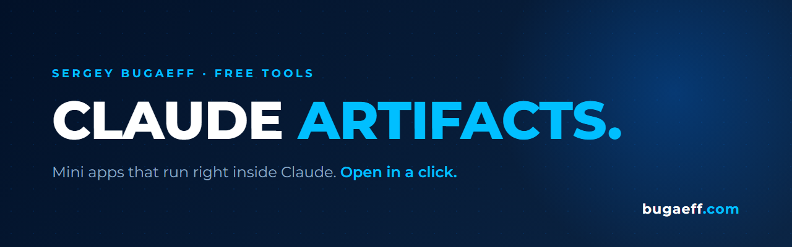

  

[← All free tools](https://github.com/bugaeff/free)

# Claude Artifacts

Small AI-powered apps that run right inside Claude. Open one in a click, use it as is or change anything you like.

## Artifacts

| Name | What it does | Link |
|---|---|---|
| Inbox Digger | Searches your Gmail by meaning: promo codes, subscriptions, things you forgot about. Bulk cleanup included. Needs Gmail connected. | [Open](https://claude.ai/artifact/LsdLeBi4MJY48yxwhzMTqA) |

New artifacts land here with every video.

## Free to use

Everything here is under the MIT license. Use it and change it however you want, commercial projects included.

## Got an idea?

Built a cool artifact or have an idea for one? Open an issue and send it over. The best ones may end up in a video.

## Need something like this for your business?

Made by **Sergey Bugaeff**, AI & Automation Consultant. These artifacts are free. For your business I build AI agents and automations around how your team actually works.

**[Book a free 20-min call →](https://cal.com/bugaeff/intro)**

[bugaeff.com](https://bugaeff.com) · [LinkedIn](https://linkedin.com/in/bugaeff) · [All free tools](https://github.com/bugaeff/free)
